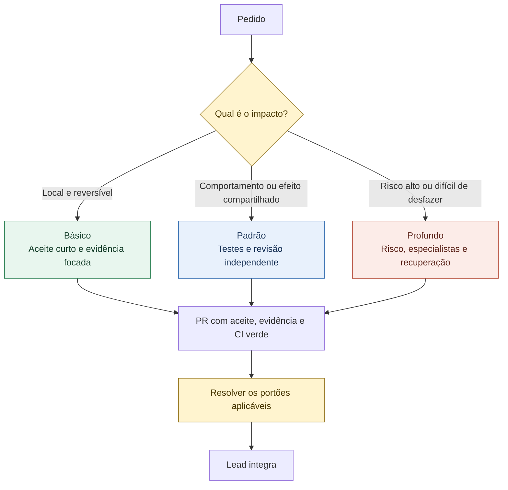
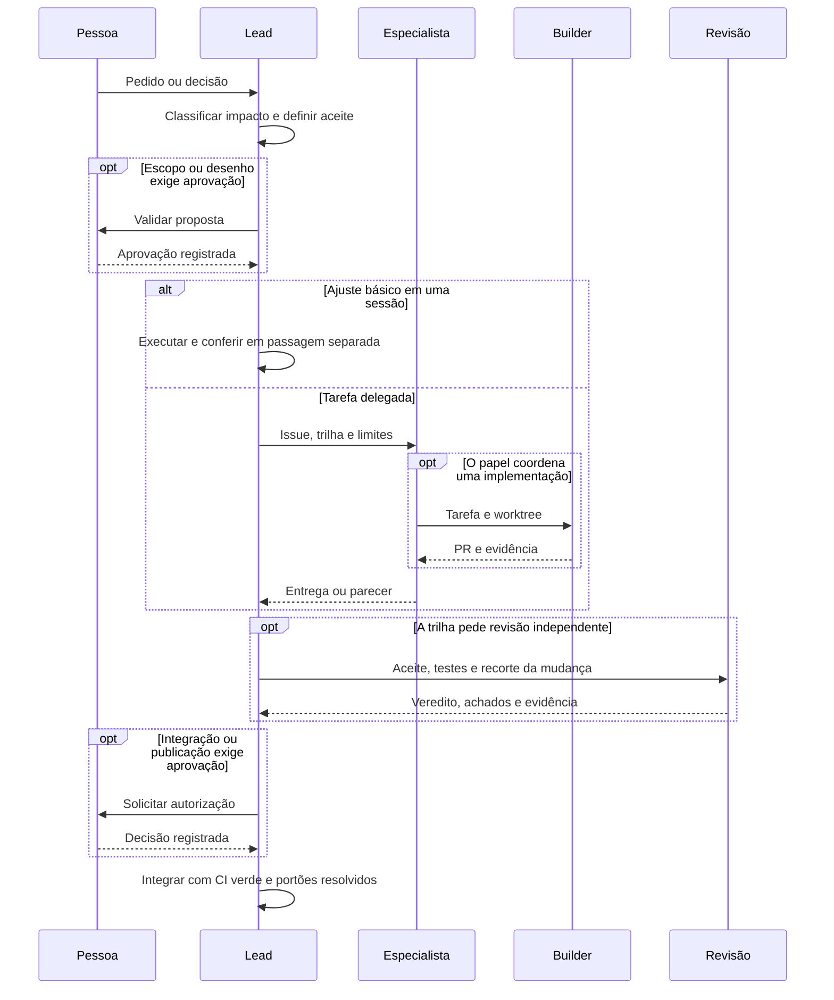

# AI Development

**Um método para desenvolver com Claude Code e Codex.** A Lead dimensiona o trabalho pelo impacto da tarefa. Os harnesses, inspirados nos agentes do Addy Osmani, definem o que cada papel recebe, como trabalha e que evidência devolve.

[Escolher a trilha](#fluxo-por-impacto) · [Conhecer os agentes](#agentes-e-harnesses) · [Preparar um projeto](#adotar-em-um-projeto-novo)

## Fluxo por impacto



| Situação | Trilha | Evidência esperada |
|---|---|---|
| Trocar a cor de um botão local dentro da identidade aprovada | **Básico** | Antes e depois, contraste, estados afetados e CI verde. Aceite no PR. |
| Criar um filtro ou mudar um componente usado em várias telas | **Padrão** | Aceite e escopo na issue. Testes quando mudar comportamento e revisão independente das regressões plausíveis. |
| Corrigir falha de autorização ou preparar migração destrutiva em produção | **Profundo** | Risco e alcance documentados, revisão especializada, contenção ou recuperação e autorização da ação. |

A Lead reclassifica se a investigação ampliar o alcance. Se o merge publica em produção, a pessoa autoriza a publicação **antes do merge**, inclusive no Básico. [Critérios, fases e portões](nucleo/01-fluxo-de-ponta-a-ponta.md)

## Agentes e harnesses

A Lead pode executar o Básico em uma sessão. Quando há delegação, o especialista recebe a tarefa, o alcance e a evidência esperada. Abre Builder quando o papel coordena implementação. Para revisão, a Lead escolhe a persona ou a sessão adequada e reúne os pareceres.



| Papel | Quando entra | Entrega |
|---|---|---|
| [**Lead**](modelos/agentes/lead.md) | Em toda tarefa | Trilha, aceite, veredito e integração |
| [**Product**](modelos/agentes/product.md) | Intenção, prioridade ou comportamento novo | Requisitos R-xx e critérios de aceite |
| [**Architect**](modelos/agentes/architect.md) | Contratos, estrutura ou risco técnico transversal | Contrato da API ou decisão técnica |
| [**Designer**](modelos/agentes/designer.md) | Identidade, tela nova ou mudança de desenho | Frames aprovados e registro em `processo/telas/` |
| [**Backend**](modelos/agentes/backend.md) | Regras de negócio, API ou dados | PR verificado contra testes e contrato |
| [**Frontend**](modelos/agentes/frontend.md) | Interface ou regressão visual | PR verificado contra frame, estados e navegador |
| [**Security**](modelos/agentes/security.md) | Fronteira sensível, vulnerabilidade ou auditoria autorizada | Alcance, evidência, gravidade e correções |
| [**Ops**](modelos/agentes/ops.md) | CI, publicação, recuperação ou incidente | Verificações, plano de operação e portão |

Os arquivos em `modelos/agentes/` usam missão e gatilho no cabeçalho, seguidos por entradas, abordagem, verificação, formato da resposta, regras e composição. Cada papel seleciona as skills pertinentes. A arquitetura aceita a ferramenta por papel ou uma ferramenta para todas as sessões. [Modelo de harness](modelos/agentes/_modelo-harness.md) · [Sessões e papéis](nucleo/02-sessoes-e-papeis.md) · [Decisão sobre ferramentas](decisoes/013-lead-e-builders-com-codex-e-claude.md)

### Agent Skills e Cloudflare

| Onde | Como o método usa |
|---|---|
| **Claude Code** | Skills e, quando a Lead solicitar, personas de revisão como `code-reviewer`, `test-engineer` e `accessibility-auditor`. |
| **Codex** | As mesmas skills. A revisão independente usa outra sessão com o harness e as skills pertinentes. |
| **Segurança** | O formato do `security-auditor` orienta pareceres. A `security-audit` da Cloudflare é a referência da auditoria completa, com escopo e aprovação próprios. |

[Personas do Agent Skills](https://github.com/addyosmani/agent-skills/blob/e997ac5b9a74eab332d5e9793bb38a38c8cfdd74/docs/agents.md) · [Guia do Codex](https://github.com/addyosmani/agent-skills/blob/e997ac5b9a74eab332d5e9793bb38a38c8cfdd74/docs/codex-setup.md) · [Testes e auditoria](nucleo/03-skills-e-testes.md)

## Adotar em um projeto novo

1. Instale Git, Node.js, GitHub CLI e o agente escolhido. Como o método está em um repositório privado, rode `gh auth login` e `gh auth setup-git` para acessar a cópia local.
2. Instale o Agent Skills na ferramenta escolhida com o [guia oficial](https://github.com/addyosmani/agent-skills#quick-start). Para auditoria, instale a skill oficial da Cloudflare.

   ```bash
   npx skills add https://github.com/cloudflare/security-audit-skill --skill security-audit --global --agent claude-code codex -y
   ```

3. Prepare um repositório Git para o produto. Da cópia local do método, gere os modelos.

   ```bash
   scripts/novo-projeto.sh /caminho/do/projeto
   ```

4. Registre a **Ferramenta por papel** em `processo/DESENVOLVIMENTO.md`. O padrão usa Claude Code para Lead, Product, Architect, Frontend e Designer. Backend, Security e Ops usam Codex. Passe `--agente claude` ou `--agente codex` para usar só uma ferramenta.
5. Se escolher [Orca](https://github.com/stablyai/orca) com agentes especialistas, passe `--especialistas` e ajuste **Nested worker depth = 2**. O gerador copia os harnesses para `processo/agentes/`. A Lead ativa os papéis conforme a entrega.
6. Em projetos com interface, configure o MCP oficial do Figma. A pessoa decide se habilita escrita.

   ```bash
   codex mcp add figma --url https://mcp.figma.com/mcp
   ```

7. Faça o primeiro commit e push após autorização. Confira CI, proteção da `main` quando disponível e a [Fase 0](nucleo/01-fluxo-de-ponta-a-ponta.md#fase-0--descobrir-a-intenção). O primeiro PR da stack ajusta os comandos e o CI do projeto.

### Atualizar um projeto que já usa o método

Compare [VERSION](VERSION) e [CHANGELOG](CHANGELOG.md). Gere os modelos numa pasta temporária com as opções do projeto. Confira o diff preparado e aplique as mudanças aprovadas em uma branch, preservando ajustes locais do CI e dos harnesses.

## Os 7 princípios

1. **Alvo claro.** Defina o resultado e o aceite antes de construir.
2. **Impacto proporcional.** Use a trilha que cobre as consequências possíveis.
3. **Teste primeiro.** Para comportamento ou bug, veja o teste falhar antes da alteração.
4. **Uma mudança por branch e PR.** Integre depois de validar e conferir o CI.
5. **Revisão independente.** Aplique no Padrão e no Profundo e registre as evidências.
6. **Evidência antes do veredito.** Declare o que verificou e o que ainda está pendente.
7. **Portões explícitos.** A pessoa decide ações de produção, irreversíveis e demais gatilhos.

## Como este repositório cresce

| Onde | O que consultar |
|---|---|
| [`nucleo/`](nucleo/) | [Fluxo](nucleo/01-fluxo-de-ponta-a-ponta.md), [sessões](nucleo/02-sessoes-e-papeis.md), [testes](nucleo/03-skills-e-testes.md), [referências](nucleo/04-referencias-e-engenharia-reversa.md) e [Git e CI](nucleo/05-git-github-e-ci.md) |
| [`modelos/`](modelos/) | Harnesses, formulários, prompts e arquivos de projeto |
| [`licoes/`](licoes/_indice.md) e [`decisoes/`](decisoes/) | Aprendizados reutilizáveis e mudanças de regra |
| [`planos/`](planos/) e [`scripts/`](scripts/) | Planos de mudança, gerador de projetos e verificador |

A retrospectiva fica na memória do projeto. Quando houver aprendizado reutilizável, registre a lição ou decisão e leve a alteração do método por PR. Use `node scripts/verificar.mjs` antes de abrir o PR. [Instruções da sessão do método](CLAUDE.md)
